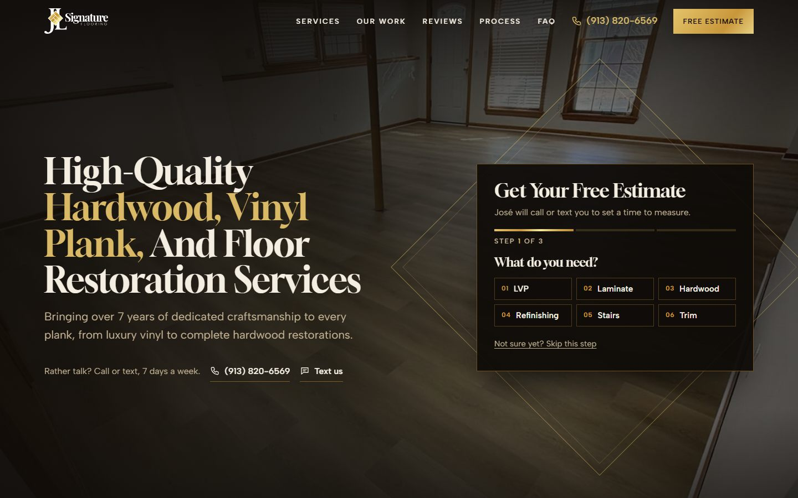
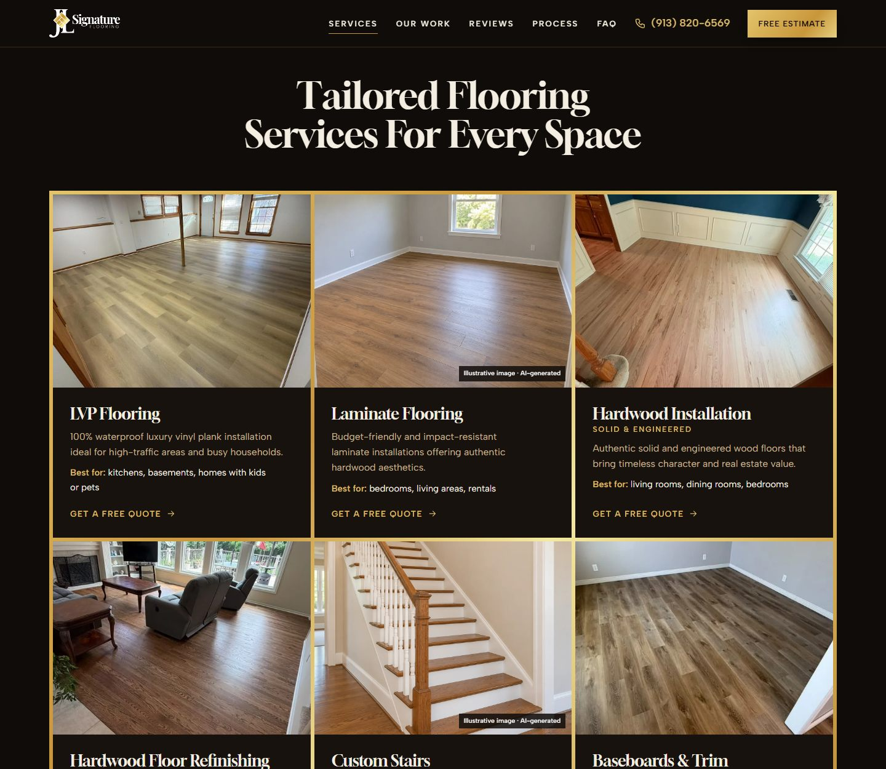
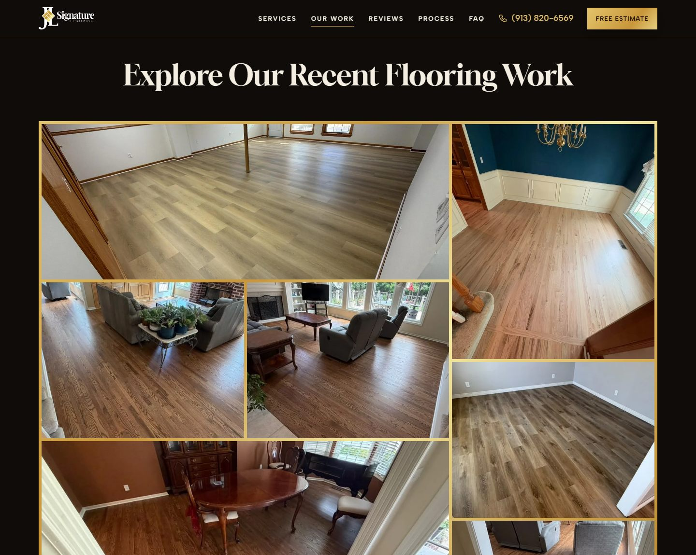
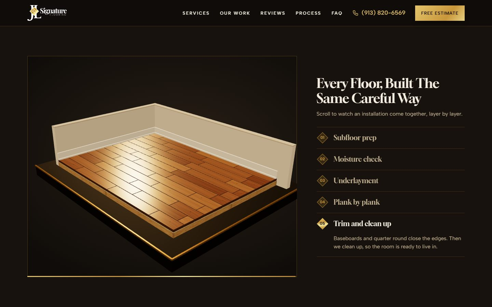
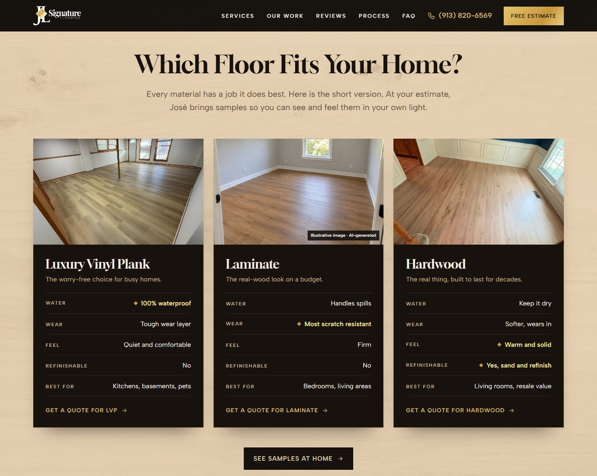
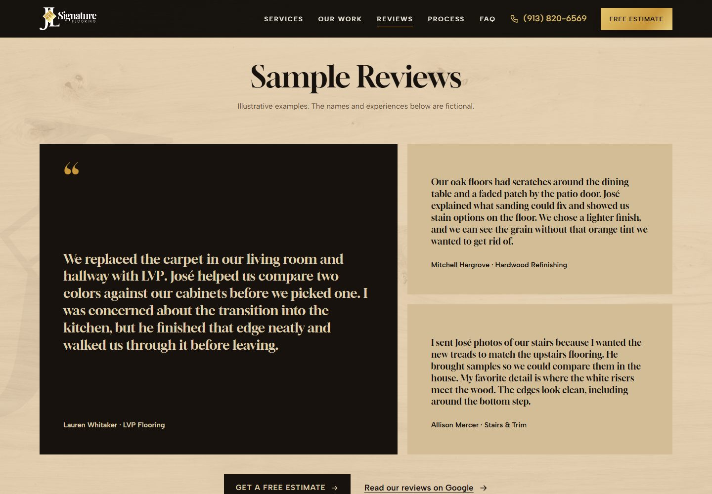
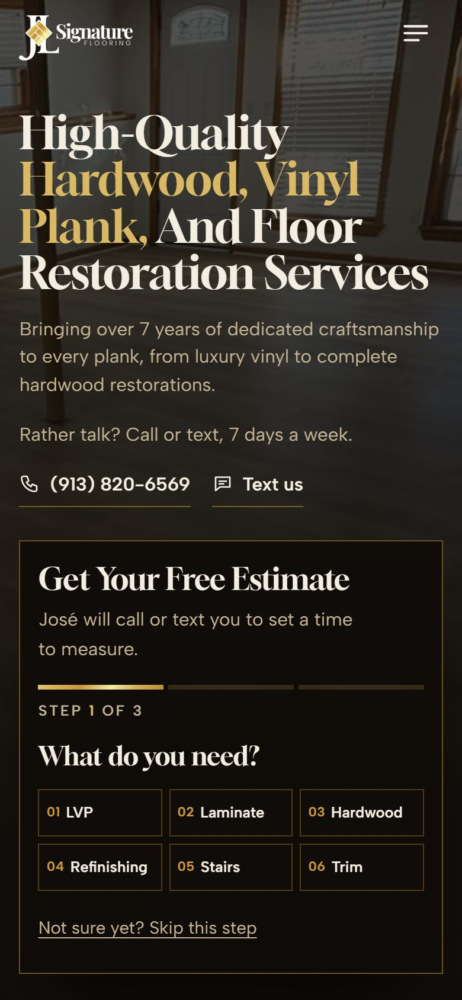

<div align="center">


# JL Signature Flooring

**Site institucional one page para uma empresa de pisos em Kansas City (EUA).**
Hardwood, LVP, laminate, refinishing, escadas e rodapés, com foco total em gerar pedidos de orçamento.

[Ambiente de teste](http://jl.escolats.com.br/) · [Site oficial](https://jlsignatureflooring.com/) · [Instagram](https://www.instagram.com/jl_signatureflooring/)


<br>



</div>

---

## Sobre o projeto

A JL Signature Flooring é uma empresa de instalação de pisos tocada pelo próprio dono, José, com mais de 7 anos de experiência. O site existe para transformar o tráfego de Meta Ads, Google Ads e Google Business Profile em pedidos de orçamento, por formulário, ligação ou mensagem de texto.

A direção visual, chamada **Parquet Grid**, nasce da própria logo: o losango de tábuas douradas vira a linguagem do site inteiro. A base é laca preta quente, as juntas são douradas e os trechos claros usam carvalho branco. As fotos são de **obras reais do José**.

<table>
  <tr>
    <td width="50%"></td>
    <td width="50%"></td>
  </tr>
  <tr>
    <td align="center"><sub>Serviços em cards com foto</sub></td>
    <td align="center"><sub>Portfólio só com projetos reais</sub></td>
  </tr>
  <tr>
    <td width="50%"></td>
    <td width="50%"></td>
  </tr>
  <tr>
    <td align="center"><sub>3D do processo, guiado pelo scroll</sub></td>
    <td align="center"><sub>Comparativo de LVP, laminate e hardwood</sub></td>
  </tr>
</table>

## Destaques

| | |
|---|---|
| **Fotos reais de obras** | Hero, About, serviços, comparativo e portfólio usam fotos de projetos do José, selecionadas numa curadoria de 31 imagens. O portfólio é 100% real. Duas imagens ilustrativas geradas por IA (escada e laminate) aparecem só nos cards e estão sinalizadas na página. |
| **3D do processo de instalação** | Na seção *Why Choose Us*, um trecho de piso é instalado em 5 etapas conforme o visitante rola a página: preparo do contrapiso, teste de umidade, manta, tábua por tábua e acabamento. Feito em Three.js, rebobina ao rolar para cima e tem versão estática para quem prefere menos movimento. |
| **Formulários em etapas** | O formulário do topo e o completo, no fim da página, são divididos em 3 passos curtos, com validação em cada etapa e máscara de telefone americano e ZIP. |
| **Feito para o celular** | Barra fixa de *Call / Text / Free Estimate*, carrosséis de deslizar e alvos de toque confortáveis. Revisado a 390px e 360px. |
| **Comparativo de materiais** | Fichas de LVP, laminate e hardwood mostram o ponto forte de cada um, com o pedido de orçamento já preenchido. |
| **Mapa da área atendida** | Leaflet com OpenStreetMap em tons escuros, com marcadores em losango dourado nas cidades atendidas. |
| **Sem framework e sem build** | Um `index.html`, um CSS e dois arquivos de JS. Basta subir os arquivos no servidor. |

<table>
  <tr>
    <td width="62%"></td>
    <td width="38%" align="center"></td>
  </tr>
  <tr>
    <td align="center"><sub>Reviews de exemplo, sinalizados como fictícios</sub></td>
    <td align="center"><sub>Versão mobile</sub></td>
  </tr>
</table>

## Seções da página

1. **Hero:** foto de um projeto real, headline e formulário de orçamento em 3 passos
2. **About:** empresa local, conduzida pelo dono
3. **Services:** 6 serviços em cards com foto
4. **Which Floor Fits Your Home?:** comparativo de LVP, laminate e hardwood
5. **Our Work:** mosaico com fotos de projetos reais
6. **Sample Reviews:** exemplos ilustrativos, identificados na página como fictícios, até entrarem avaliações verificadas
7. **Why Choose Us:** diferenciais e o 3D do processo
8. **How It Works:** os 3 passos até o piso novo
9. **FAQ:** dúvidas frequentes
10. **Estimate:** formulário completo em etapas e mapa da área atendida

## Identidade visual

| Token | Cor | Uso |
|---|---|---|
| `--lacquer` | `#0f0c09` | Fundo principal (laca preta quente) |
| `--gold` | `#c9963a` | Juntas, marcadores e detalhes |
| `--leaf` | gradiente `#e3c46b` → `#f3e9a0` | Folha de ouro dos botões e destaques, tirada da logo |
| `--oak` | `#dfcdac` | Seções claras, sobre textura de carvalho |
| `--bone` | `#f4ede1` | Texto sobre fundo escuro |
| `--ink` | `#17120d` | Texto sobre fundo claro |

**Tipografia:** [Gloock](https://fonts.google.com/specimen/Gloock) nos títulos (serifa de alto contraste, parente do "Signature" da logo) e [Albert Sans](https://fonts.google.com/specimen/Albert+Sans) nos textos e rótulos. O ícone da logo aparece como marca d'água em About, Why Choose Us, Reviews, FAQ e no rodapé.

O sistema completo (cores, tipografia, componentes e movimento) está documentado em [`DESIGN.md`](DESIGN.md).

## Estrutura

```
.
├── index.html                  # a página inteira
├── assets/
│   ├── css/style.css           # estilos
│   ├── js/main.js              # formulários, menus, mapa, máscaras, interações
│   ├── js/process3d.js         # 3D do processo (Three.js, carregado sob demanda)
│   ├── img/projects/           # fotos reais de obras do José
│   ├── img/illustrative/       # 2 imagens ilustrativas geradas por IA (sinalizadas)
│   ├── img/                    # textura de carvalho e arquivos provisórios antigos (sem uso)
│   └── logo/                   # versões da logo usadas no site
├── Logos/                      # arquivos originais da marca
├── docs/
│   ├── FOTOS-CURADORIA.md      # critérios e seleção das fotos
│   ├── fotos-catalogo.html     # catálogo visual das fotos analisadas
│   ├── fotos-manifest.json     # origem, dimensões e uso de cada foto
│   ├── fotos-prompts.md        # prompts das imagens ilustrativas
│   └── preview-*.jpg           # imagens deste README
├── .htaccess                   # cache, compressão, segurança e noindex do ambiente de teste
├── robots.txt
├── sitemap.xml
├── DESIGN.md                   # sistema visual
└── PRODUCT.md                  # contexto do produto e do público
```

## Fotos

As fotos reais vieram da pasta compartilhada do cliente: **31 analisadas, 7 selecionadas**, convertidas para WebP sem ampliação, sem remoção de objetos e sem alteração de cores. Critérios, limites e a lista completa estão em [`docs/FOTOS-CURADORIA.md`](docs/FOTOS-CURADORIA.md).

- A distribuição das fotos nos cards de serviço é uma proposta visual. **Confirmar com o José** o serviço e o material de cada obra.
- As imagens geradas por IA (escada e laminate) **nunca** devem ser usadas como portfólio ou como prova de trabalho executado.

## Rodando localmente

Não precisa instalar nada. Basta servir a pasta com qualquer servidor estático:

```bash
npx http-server -p 5517 -c-1
# ou
python -m http.server 5517
```

Depois acesse `http://127.0.0.1:5517`.

> Abrir o `index.html` direto pelo arquivo (`file://`) não carrega o 3D, porque módulos ES exigem um servidor.

## Publicação

**Ambiente de teste** (`jl.escolats.com.br`): suba `index.html`, `assets/`, `.htaccess`, `robots.txt` e `sitemap.xml`. Nesse ambiente o `.htaccess` e o `robots.txt` bloqueiam a indexação nos buscadores.

**Domínio oficial** (`jlsignatureflooring.com`):

1. No `.htaccess`, remova o bloco *TEST ENVIRONMENT* e ative o bloco de HTTPS.
2. No `robots.txt`, use a versão de produção que está comentada no próprio arquivo.
3. No `sitemap.xml`, troque as URLs para `https://jlsignatureflooring.com/`.

## Antes de ir ao ar

- [ ] Chave do **Web3Forms** no `index.html` (procure `YOUR_WEB3FORMS_ACCESS_KEY`). Ela vale para os dois formulários.
- [ ] Trocar os **reviews de exemplo** por avaliações reais e verificadas do Google (o aviso "Illustrative examples" sai junto)
- [ ] Confirmar com o José o **serviço e o material** de cada foto usada nos cards
- [ ] Substituir as **imagens ilustrativas** de escada e laminate por fotos reais quando houver
- [ ] Confirmar a **lista de cidades** atendidas (array `CITIES` em `assets/js/main.js`) e o selo de **licença e seguro**
- [ ] Trocar `.htaccess`, `robots.txt` e `sitemap.xml` para a versão de produção

## Créditos

- Fotos de projetos: JL Signature Flooring
- Imagens ilustrativas: geradas por IA, sinalizadas no site ([prompts](docs/fotos-prompts.md))
- Textura de carvalho: [Unsplash](https://unsplash.com) (Unsplash License)
- 3D: [Three.js](https://threejs.org) (MIT)
- Mapa: [Leaflet](https://leafletjs.com) (BSD-2) e © [OpenStreetMap](https://www.openstreetmap.org/copyright) contributors
- Fontes: Gloock e Albert Sans, via Google Fonts (SIL Open Font License)

---

<div align="center">
<sub>Desenvolvido por <strong>Eu Sou TS</strong> para a JL Signature Flooring · © 2026 JL Signature Flooring. Todos os direitos reservados.</sub>
</div>
